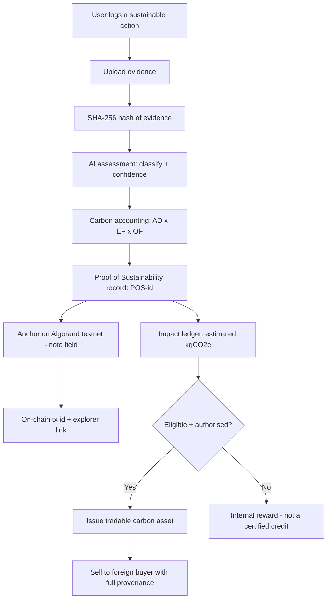

I've spent enough time inside carbon markets to know their dirty secret: the problem was never the credits, it was the **trust**. A buyer in Europe has no way to know whether the recycling that generated your credit actually happened, or whether the same tonne was sold three times. That trust gap is why good projects get priced like bad ones. CarbonGero is my team's attempt to close it — by making every tonne carry its own evidence. Here is the full model, start to finish, with nothing hand-waved.

## The core idea: Proof of Sustainability

Most platforms start with the token. We start one layer lower, with **proof**. Every sustainable action — a kilo recycled, a kilometre not driven — is captured as a **Proof of Sustainability**: an evidence-backed, cryptographically hashed, independently traceable record. The credit is downstream of the proof, not the other way around.

> The order matters. Tokenise first and you've put a wrapper on an unverified claim. Prove first and the token is just a receipt for something real.

## The end-to-end flow

Here's what actually happens when a user submits an activity on CarbonGero. I'll give you the real pipeline, because the hand-offs are the whole product.



Walk the right-hand branch: a proof only becomes a *sellable, certified* carbon asset when it passes eligibility and authorisation. Until then it's an internal reward — and we label it as exactly that. We never dress up an estimate as a verified credit. That discipline is the entire value proposition.

## Why each stage exists

| Stage | What it solves | Technology |
|---|---|---|
| Evidence hash | Tamper-proof, de-duplicable record | SHA-256 |
| AI assessment | Fast first-pass verification at scale | Classification + confidence |
| Carbon accounting | Honest, methodology-based impact | GHG formula: Activity × Emission Factor × Oxidation Factor |
| Proof registry | One tonne = one unforgeable record | Append-only ledger (Postgres) |
| Algorand anchor | Public, cheap, immutable traceability | ASA + note-field transactions |
| Asset issuance | A unit a market can price and trade | Algorand Standard Assets |

```chart
{"type":"bar","title":"Carbon accounting, worked example","caption":"12.5 kg recycled x 1.8 emission factor = 22.5 kg gross avoided; minus a conservative 10% leakage = 20.25 kgCO2e net — the figure CarbonGero anchors on-chain.","categories":["Gross avoided","Leakage (-10%)","Net reduction"],"series":[{"name":"kgCO2e","data":[22.5,2.25,20.25]}],"colors":["#00C853","#9CA3AF","#00D1B2"],"distributed":true,"options":{"dataLabels":{"enabled":true},"legend":{"show":false}}}
```

## Why Algorand, specifically

People ask why not just use a database. Because a database is trusted by *you*; a buyer in another jurisdiction has no reason to. Anchoring the proof reference on **Algorand** gives a neutral, public, low-cost, carbon-negative ledger that anyone can independently verify — the explorer link is the handshake. Transactions cost a fraction of a cent and settle in seconds, which matters when you're anchoring thousands of small MSME actions, not a handful of mega-projects. And unlike a proof-of-work chain, you're not burning carbon to certify carbon savings, which would be absurd.

## The accumulation story for MSMEs

A single recycling action is worth almost nothing. The model only works when you **aggregate** — and aggregation is exactly where evidence usually falls apart, because now you're trusting a thousand small claims instead of one big one. CarbonGero's answer is that each of those thousand claims already carries its own hash, AI assessment and on-chain anchor. So a foreign buyer isn't trusting the aggregator's spreadsheet — they're verifying a portfolio where every tonne links back to its own proof.

| Without proof-first | With CarbonGero |
|---|---|
| Buyer trusts the seller's claim | Buyer verifies each tonne on-chain |
| Double-counting is easy | Evidence hashes block duplicates |
| Small actions can't be aggregated credibly | Thousands of proofs stack cleanly |
| "Estimated" and "verified" get blurred | They are explicitly separated |

## Selling across borders

This is where the model pays off. A European buyer navigating CBAM, or a corporate meeting a net-zero target, is desperate for **high-integrity** credits with provenance. A CarbonGero asset arrives with its entire lineage attached — the activity, the evidence hash, the methodology, the on-chain anchor. That provenance is what lets an Indian MSME's recycled tonne command the same trust as a mega-project's, and sell into the same global demand under the voluntary market and, as it opens, Article 6.

## Where we are honest

In the current build, the **AI assessment and the Algorand anchoring are configurable** — the anchor runs on Algorand TestNet, and impact is always labelled *estimated* until it clears an applicable verification and authorisation process. We'd rather ship a system that tells the truth about its own maturity than one that over-claims. The architecture, though, is the real thing: evidence in, proof out, anchored on a public ledger, ready to become a tradable asset the moment it's eligible.

Real-world action → verifiable evidence → measurable impact → digital proof → authorised asset. That's the whole loop, and it's the loop carbon markets have been missing.

## Sources

- [India's carbon market: architecture to execution — AgroSpectrum](https://agrospectrumindia.com/news/116/34614/indias-carbon-market-moves-from-architecture-to-execution.html)
- [Carbon Credits for MSMEs India — Carbon Market Network](https://carbonmarketnetwork.com/blog/carbon-credits-for-msmes-india/)
