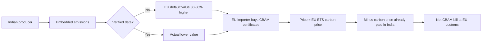

For two years CBAM was a reporting exercise — a form you filed and forgot. On **1 January 2026** that ended. The EU's Carbon Border Adjustment Mechanism entered its *definitive* phase, which is a polite way of saying the money is now real. If you ship steel or aluminium to Europe from India, a carbon charge is now attached to every tonne, and in my experience most exporters have badly underestimated it.

## What CBAM actually does

Strip away the acronyms and CBAM is one idea: **tax imported carbon at the EU's own carbon price so that European factories don't lose to dirtier foreign ones.** An EU importer buying your steel has to surrender CBAM certificates covering the *embedded emissions* in that steel, priced off the EU ETS. If you already paid a carbon price at home, you can deduct it — but only if you can prove it.

> Roughly €8–9 billion of India's exports to the EU sit inside CBAM's scope every year — and about 90% of that is iron, steel and aluminium. This is not a niche problem.

## The sectors and the bill

CBAM's definitive regime covers six sectors. For India, two of them are almost the entire story.

| Sector | In scope? | India exposure |
|---|---|---|
| Iron & Steel | Yes | **Largest** — the core of the hit |
| Aluminium | Yes | High — coal-powered smelting |
| Cement | Yes | Lower volume to EU |
| Fertilisers | Yes | Moderate |
| Hydrogen | Yes | Emerging |
| Electricity | Yes | Minimal for India |

## Why the number is worse than it looks

Here is the part that catches finance teams off guard. If you cannot report **verified, actual** emissions, CBAM applies **default values** — and those defaults are punitive by design, because the EU wants to push everyone toward measurement.

| Driver | Effect |
|---|---|
| Default emission values | Can run **30–80% above** a plant's real emissions |
| Production route | Blast-furnace/BOF steel and coal-power aluminium carry the highest burden |
| Effective margin hit | Analysts estimate **15–22%** price cuts to absorb the charge |
| Early trade impact | India's iron & steel shipments to the EU already fell ~13% in the first four months |

ICRIER has estimated CBAM could cut India's steel exports to the EU by **up to 24%**. Sit with that number. A quarter of a market, taxed away not because the product is worse, but because its carbon is both higher *and* un-measured.

```chart
{"type":"bar","title":"CBAM's bill on Indian exporters (2026)","caption":"Figures in %. Sources: ICRIER, GTRI, India Commerce Ministry.","categories":["Projected steel export cut","Early drop (first 4 months)","Default-value premium (upper)","Margin hit to absorb (upper)"],"series":[{"name":"%","data":[24,13,80,22]}],"colors":["#00C853"],"horizontal":true,"options":{"dataLabels":{"enabled":true}}}
```

## How the charge actually flows

I draw this for every exporter, because the leverage points are the two places you can intervene: measuring real emissions, and proving a domestic carbon price.



Everything to the left of "EU importer" is inside your control. Everything to the right is Brussels. The exporters who win are the ones who move left — measure, verify, decarbonise, and document any Indian carbon cost so it can be deducted.

## The carbon-colonialism fight

Now the controversial part, and I won't pretend to be neutral. India, along with much of the Global South, calls CBAM **unilateral green protectionism** — a rich bloc that industrialised on coal now raising a toll gate on everyone climbing the same ladder. It arguably cuts against the Paris principle of *common but differentiated responsibilities*. The word being used in Delhi is "carbon colonialism," and it is not just rhetoric: CBAM revenue stays in the EU, not with the developing-country producer footing the decarbonisation bill.

The EU's rebuttal is also fair: without a border charge, European industry simply offshores its emissions, and the planet gains nothing. That is "carbon leakage," and it is a genuine problem.

Both can be true. CBAM is simultaneously a reasonable climate instrument and a transfer of cost and control toward Europe. My read, having watched the first four months of data: the countries that will win this are the ones that **build their own carbon price fast**, so the revenue is captured at home and deductible at the EU border — which is exactly what India's CCTS is for.

## What exporters should do this quarter

1. **Measure real emissions** per product. Defaults are a tax on not knowing.
2. **Verify** with a credible third party — EU importers will demand it.
3. **Document the Indian carbon cost** (CCTS exposure) so it can be deducted.
4. **Decarbonise the hot spots** — the BF-BOF route and coal power are where the bill is concentrated.

CBAM is not going away, and it is widening. Treating it as a compliance nuisance is how you lose 20% of a European order book. Treating it as a signal to measure and decarbonise is how you keep it.

## Sources

- [EU carbon tax from 2026 to dent India's steel, aluminium exports — Maritime Gateway / GTRI](https://www.maritimegateway.com/eu-carbon-tax-from-2026-set-to-dent-indias-steel-aluminium-exports-gtri/)
- [EU CBAM 2026: A Practical Guide for Exporters — OneStopESG](https://onestopesg.com/esg-news/eu-cbam-2026-exporter-guide-carbon-border-tax)
- [CBAM Impact on Indian Exporters 2026 — Anaxee](https://blog.anaxee.com/cbam-impact-indian-exporters-2026/)
