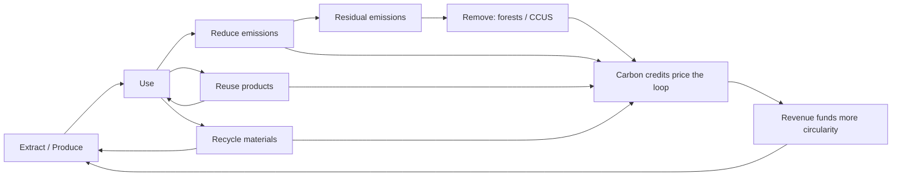

There is a comfortable lie in the carbon conversation: that if we just buy enough offsets, the math works out. It doesn't. An offset is a patch, not a system. If India is serious about **net-zero by 2070**, the real design problem is not "how do we offset emissions" — it's "how do we build an economy where carbon circulates instead of accumulating." That is the circular carbon economy, and offsets are only its last resort.

## Linear carbon is the actual problem

The economy we inherited is a straight line: dig up carbon, burn it, dump the CO₂ into the sky, repeat. Every tonne is a one-way trip. A circular carbon economy bends that line into a loop — keeping carbon in use, in products, and out of the atmosphere for as long as possible.

> Offsetting is what you do with the carbon you *couldn't* avoid. If it's your first move instead of your last, you've already lost the plot.

## The four moves, in priority order

I think of it as a strict hierarchy. You exhaust each move before spending money on the next one down.

| Move | What it means | Example | Cost logic |
|---|---|---|---|
| **1. Reduce** | Don't emit in the first place | Efficiency, renewables, demand shifts | Cheapest tonne is the one never emitted |
| **2. Reuse** | Keep carbon-rich products in service | Remanufacturing, longer product life | Avoids re-emitting to re-make |
| **3. Recycle** | Recover material, avoid virgin production | Steel/aluminium/plastic recycling | Huge avoided emissions per tonne |
| **4. Remove** | Pull CO₂ back out | Afforestation, CCUS, direct air capture | Expensive — do last, at scale |

Most corporate "net-zero" plans quietly invert this hierarchy — a little reduction, then a mountain of cheap removals on paper. The circular model refuses that shortcut.

## Where carbon credits actually fit

Credits are not the economy; they are the **accounting layer and the price signal** that makes the loop pay. A credit rewards a tonne reduced, reused, recycled or removed — and a market price tells every actor which move is worth making. Without the credit, the recycler's avoided emissions are invisible. With it, they're an asset.

The key arrow is the last one: credit revenue flows *back* into funding the next reduction. That feedback loop is what separates a circular economy from a greenwashing exercise.

## CCUS: the honest role of removal

Carbon Capture, Utilisation and Storage gets hyped as a silver bullet and dismissed as a fossil-industry delay tactic. Both camps are wrong. For **hard-to-abate** sectors — cement chemistry, some steel, fertiliser — there is no efficiency trick that gets you to zero. You will have residual emissions, and you will need to capture and either use or store them. India's cement and steel heartlands are exactly where CCUS earns its place. The mistake is using it as an excuse to *not* reduce first.

| Carbon use case | Circular role | Maturity in India |
|---|---|---|
| CO₂ to building materials | Utilisation (locks carbon in concrete) | Early |
| Enhanced recovery / chemicals | Utilisation | Pilot |
| Geological storage | Removal | Nascent |
| Afforestation / soil carbon | Removal + co-benefits | Scaling |

## Why MSMEs are the circular engine

Here's an under-appreciated point: the **circular economy is physically operated by small businesses.** The kabadiwala, the scrap aggregator, the recycler, the refurbisher — they are already running the "reuse" and "recycle" loops, just without carbon accounting. Formalising their avoided emissions into credits does two things at once: it rewards work that is already happening, and it channels capital toward the cheapest, highest-integrity tonnes in the system.

This is where the policy and the product meet. India's CCTS **offset mechanism** and the global **voluntary market** are the rails; MSMEs are the rolling stock; and the circular hierarchy tells everyone which tonne to chase first.

## The design principle

If I had to compress the whole thing into one sentence: **make the atmosphere the most expensive place to put carbon, and the loop closes itself.** Price the externality, reward the avoided tonne, fund the next reduction with the revenue, and reserve removals for what you genuinely cannot avoid. That is not idealism — it is just good systems design applied to the one waste stream we've been giving away for free.

India has the pieces: a carbon market switching on, a vast informal circular workforce, and a 2070 target that forces the long view. The work now is wiring them into a loop instead of a line.

## Sources

- [India's carbon market moves from architecture to execution — AgroSpectrum](https://agrospectrumindia.com/news/116/34614/indias-carbon-market-moves-from-architecture-to-execution.html)
- [India's Article 6 framework and climate finance — CETEx](https://cetex.org/wp-content/uploads/2026/09/Indias-Article-6-framework-and-climate-finance.pdf)
- [India's Carbon Credit Market 2026-27 and Beyond — BuildToSustain](https://buildtosustain.net/blog/india-carbon-credit-market-2026/)
