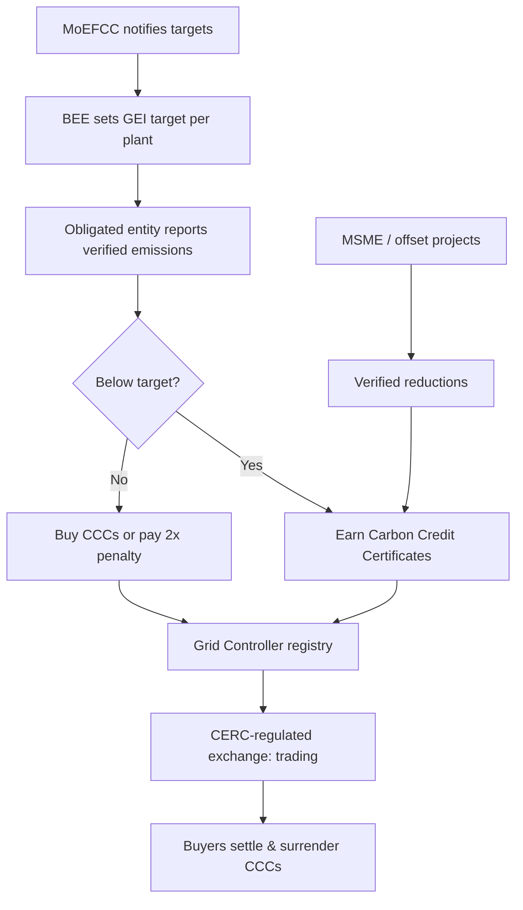

I build carbon infrastructure for a living, and for most of 2026 the single most common question I get is some version of: *"So is India's carbon market real now, or is it still a PowerPoint?"* The honest answer is that it crossed over. The portal is live, the targets are notified, and the first real penalties are now only a compliance cycle away. Here is what the Carbon Credit Trading Scheme actually is, without the consulting-deck fog.

## What CCTS actually is

CCTS is India's national carbon market. It is run by the **Bureau of Energy Efficiency (BEE)** under the Energy Conservation Act, with emission targets notified by the **Ministry of Environment (MoEFCC)**. The **Grid Controller of India** keeps the registry, and **CERC** regulates the trading itself.

The unit of currency is the **Carbon Credit Certificate (CCC)** — one certificate represents one tonne of CO₂-equivalent. If you emit less than your target, you earn certificates. If you emit more, you buy them. That is the whole game, and it is the same logic that powers the EU ETS and China's market.

> India is on track to become the world's third-largest carbon market, behind only China and the EU. That is not a forecast for 2040 — the trading starts now.

## The two engines: compliance and offset

People constantly conflate these, so let me separate them cleanly. CCTS has **two distinct mechanisms**, and which one applies to you changes everything.

| | Compliance mechanism | Offset mechanism |
|---|---|---|
| **Who** | ~490 large plants, 9 hard-to-abate sectors | Anyone not obligated — incl. MSMEs, developers |
| **Nature** | Mandatory, legally binding | Voluntary, project-based |
| **Target** | A GHG Emission Intensity (GEI) target per unit of output | No target — you register a reduction project |
| **You earn credits by** | Beating your intensity target | Delivering verified emission reductions |
| **You can lose by** | Missing the target → pay a penalty | Nothing is forced on you |

The compliance side is the heavy machinery. The offset side is the door through which the rest of the economy — including the recycler, the solar rooftop, the EV fleet — walks in.

```chart
{"type":"bar","title":"Why a Carbon Credit Certificate has real value","caption":"CCTS prices non-compliance at 2x the market rate — so buying a credit always beats paying the penalty. That multiplier is what gives the certificate value.","categories":["Buy a credit","Non-compliance penalty"],"series":[{"name":"Cost (x market price)","data":[1,2]}],"colors":["#00C853","#EF4444"],"distributed":true,"options":{"dataLabels":{"enabled":true},"plotOptions":{"bar":{"columnWidth":"45%"}},"legend":{"show":false}}}
```

## Who is obligated

Nine energy-intensive sectors carry binding targets. If you run a plant in these, July 2026 is already circled on your calendar.

| Sector | Why it's in | Notes |
|---|---|---|
| Iron & Steel | ~12% of India's industrial CO₂ | Highest-exposure, also hit hardest by EU CBAM |
| Cement | Process + fuel emissions | Hard to abate chemically |
| Aluminium | Coal-powered smelting | Electricity is the carbon |
| Fertiliser | Ammonia/urea energy intensity | Food-security sensitive |
| Chlor-alkali, Pulp & Paper, Petroleum Refining, Petrochemicals, Textiles | Energy-intensive processes | Rounding out the nine |

Targets are expressed as **intensity**, not absolute emissions — tonnes of CO₂ per tonne of product. That is deliberate: it lets efficient plants grow while still squeezing the carbon out of each unit.

## How a certificate is born and traded

Here is the pipeline I draw for every client, because the hand-offs are where people get lost.



Notice the bottom branch: offset projects feed the *same* certificate pool. A compliance buyer short on credits can, in principle, buy from an offset generator. That linkage is what makes the market liquid — and what makes it interesting for small players.

## The 2026-27 timeline

This is the part that turned CCTS from theory into deadline.

| When | What happened / happens |
|---|---|
| Oct 2025 – Jan 2026 | Sectors notified; GEI targets issued |
| March 2026 | CERC's CCC Regulations notified; Indian Carbon Market (ICM) portal goes live |
| **31 July 2026** | First compliance deadline — Form A for FY 2025-26 |
| ~October 2026 | First compliance-based CCC trades expected |
| FY 2026-27 onward | Annual cycles, tightening targets |

If you are an obligated entity and you are reading this after July 2026 without having filed, you are already exposed.

## The controversial bit

Here is my opinion, earned from watching three carbon markets: the **penalty design is the whole ballgame**. CCTS sets non-compliance at **twice the average CCC market price** per tonne of shortfall. That 2x multiplier is what gives a certificate real monetary value — a plant will always rather buy a credit at 1x than pay a penalty at 2x. Get that number wrong and the market is a museum piece; get it right and it prices carbon into every tonne of steel.

The open question nobody has fully answered: will India keep the carbon *inside* the country, or let it flow to foreign buyers under Article 6? That tension — domestic decarbonisation versus export revenue — is the real story of India's carbon decade. I'll dig into it in the companion pieces on CBAM and MSME exports.

For now, the takeaway is simple. The market is no longer coming. It is here, it has a deadline, and the price of ignoring it is literally two times the price of participating.

## Sources

- [CCTS Reporting in India — Climes](https://www.climes.io/ccts-reporting-india)
- [CCTS Obligated Entities: Which Sectors Are Covered — FloraCarbon](https://floracarbon.ai/learn/ccts/obligated-entities/)
- [India CCTS 2025-2026 Complete Guide — CarbonNeeti](https://carbonneeti.com/blog/ccts-india-2025-2026-complete-guide)
