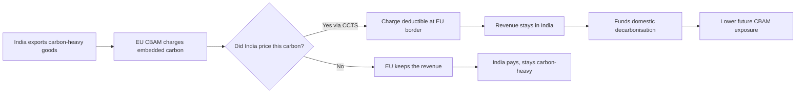

Let me say the quiet part out loud: the EU's carbon border tax and India's new carbon market are on a collision course, and it is one of the most consequential trade fights of the decade that almost nobody is covering properly. This isn't a morality play with a hero and a villain. It's a hard-nosed contest over **who gets to price carbon, and who gets to keep the money.** Here's my read, with the receipts.

## The setup

On one side: the **EU's CBAM**, live in its definitive form since January 2026, taxing the embedded carbon in imported steel, aluminium, cement, fertiliser, hydrogen and electricity. On the other: **India's CCTS**, switching on its first compliance cycle in 2026, building what will become the world's third-largest carbon market. Both are pricing carbon. The fight is about *whose* price counts at the border.

> If India doesn't price its own carbon, Brussels prices it for them — and pockets the revenue. That single sentence explains the entire strategy.

## The leverage map

Strip the diplomacy away and look at who actually holds what.

| Lever | EU | India |
|---|---|---|
| Market access | Controls entry to a huge, rich market | Needs the access (€8-9B exposed) |
| Carbon price | Mature (EU ETS) | New (CCTS, FY2025-26 first cycle) |
| Moral high ground | "Preventing carbon leakage" | "CBDR — you industrialised on coal" |
| Revenue capture | Keeps CBAM revenue | Can capture it *if* it prices carbon first |
| Supply leverage | Can source elsewhere | Key supplier in steel/aluminium |

The EU holds the demand. India holds supply and a legitimate fairness argument. Neither can simply dictate to the other — which is why this becomes a negotiation, not a surrender.

## Why "carbon colonialism" is both true and incomplete

India's case is strong and I won't pretend otherwise. CBAM is **unilateral**: Brussels designed it, Brussels collects it, and the developing-country producer pays the decarbonisation bill while the revenue stays in Europe. It cuts against *common but differentiated responsibilities*, the principle that the countries which filled the atmosphere first should carry more of the cost. Calling it "carbon colonialism" is rhetorically sharp but not baseless.

And yet. The EU's counter is also real: if Europe taxes its own industry's carbon but lets dirtier imports in free, production just migrates and global emissions don't fall. That's **carbon leakage**, and it's a genuine failure mode. A border adjustment is a defensible fix for it.

So both things are true. CBAM is a reasonable climate instrument *and* a transfer of cost and control toward the rich bloc. Pretending it's only one or the only the other is how commentators get this wrong.

## The flow of the fight

Here's the strategic picture — notice where India can intervene.

The entire game is node **C**. If India prices its own carbon through CCTS, that cost becomes deductible against the CBAM bill — so the money is captured at home and recycled into cleaning up the very industries CBAM targets. If it doesn't, the money just leaves.

## How India could actually revolutionise this

This is where I get opinionated, because the conventional "retaliate with tariffs" take is weak. Tariffs hurt India's own importers and invite escalation. The real play is more interesting:

1. **Price carbon fast and credibly.** A functioning CCTS price is India's single best weapon — it converts a foreign tax into a domestic, deductible, revenue-capturing one.
2. **Make Indian carbon the most *verifiable* carbon on earth.** CBAM punishes un-measured emissions with punitive defaults (30-80% above actual). The exporter with bullet-proof, on-chain, AI-verified emissions data doesn't just avoid the penalty — they out-compete rivals still shipping blind.
3. **Build the trust rails for exports.** As Article 6 opens, the country with the cleanest provenance infrastructure sells the premium credits. That's a first-mover advantage India can actually take.
4. **Negotiate from supply strength**, not grievance. India is too important a supplier to simply be dictated to — but only if it shows up with a real carbon price and real data, not just a complaint.

| Strategy | Weak version | Strong version |
|---|---|---|
| Response to CBAM | Retaliatory tariffs | Domestic carbon price (deductible) |
| Emissions data | Accept default values | Verified, on-chain, AI-audited |
| Export credits | Wait and protest | Build provenance rails, sell premium |
| Posture | Victim | Supplier with leverage |

## The uncomfortable conclusion

Here's the fact-based take nobody in either camp loves: **CBAM might be the best thing to happen to India's carbon market.** Not because it's fair — it isn't entirely — but because it creates an irresistible financial reason to do what India needed to do anyway: price carbon, measure emissions, and clean up steel and aluminium. The EU built a stick. India's move is to turn that stick into a reason to build its own, better, revenue-keeping system.

The clash is real, the stakes are in the billions, and the winner won't be whoever shouts "colonialism" or "leakage" loudest. It'll be whoever prices and proves their carbon first. Right now, that's up for grabs — and India, uniquely, has every piece it needs to grab it.

## Sources

- [EU carbon tax to dent India's steel, aluminium exports — Maritime Gateway / GTRI](https://www.maritimegateway.com/eu-carbon-tax-from-2026-set-to-dent-indias-steel-aluminium-exports-gtri/)
- [India's new role in carbon markets under Article 6 — CETEx](https://cetex.org/news/emission-economy-indias-new-role-in-carbon-markets-under-article-6/)
- [CBAM 2026: What EU Carbon Border Rules Mean for India — GreenCentral](https://www.greencentral.in/2026/03/16/cbam-eu-carbon-border-tax-india/)
