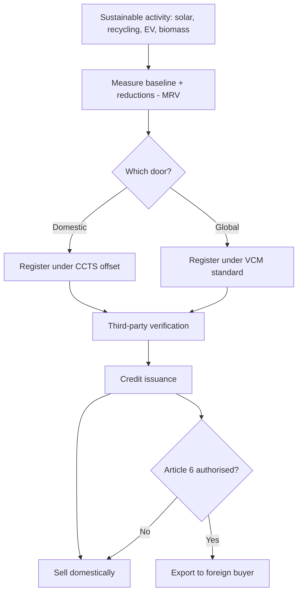

Most of the carbon-market coverage in India is written for the 490 giant plants under the compliance net. But the people who actually email me are not running a steel mill — they run a 40-person recycling unit in Pune, a solar EPC in Jaipur, a logistics fleet in Surat. Their question is blunt: *"Can I make money from carbon, or is this only for the big guys?"* The answer in 2026 is yes — and here is the real playbook, including the parts the glossy webinars skip.

## Why MSMEs are suddenly in the game

India's **CCTS compliance mechanism is not mandatory for you.** It binds ~490 large plants in nine energy-intensive sectors. For everyone else, the government opened a **voluntary offset mechanism** — you register an eligible project, deliver verified reductions, and earn Carbon Credit Certificates. That single design choice is what lets a small business participate without being a regulated polluter.

> You are not obligated. That is the point. For an MSME, carbon is a revenue line, not a liability.

## The two doors

This is the fork everything hangs on. There are **two separate markets** you can sell into, and confusing them is the most common mistake I see.

| | Door 1 — CCTS Offset (domestic) | Door 2 — Voluntary Carbon Market (global) |
|---|---|---|
| **Run by** | BEE / Govt of India | Verra, Gold Standard, etc. |
| **Buyers** | Indian firms, obligated entities | Global corporates, foreign buyers |
| **Liquidity today** | Building (new) | Already deep and liquid |
| **Export?** | Only once *authorised* under Article 6 | Yes — foreign buyers directly |
| **Best for** | India-first, policy-aligned credits | Faster access to foreign demand |

If your goal is to **sell to foreign people today**, Door 2 (the global VCM) is the open road. Door 1 is the domestic scheme that is still wiring up its international plumbing.

## From activity to credit — the actual journey

Here is the end-to-end path, the one I walk every MSME through. The hard part is never the idea; it is the **MRV** — measurement, reporting and verification — in the middle.

The nodes that cost money and time are **B** (measuring it credibly) and **F** (getting it verified). Everything else is paperwork and a marketplace.

## What "export" really means — and the catch

This is where I have to be honest, because a lot of people are being sold a fantasy. A domestic **Carbon Credit Certificate cannot simply be wired to a buyer in Frankfurt.** International transfer of CCTS credits is allowed **only once they are authorised under Article 6** of the Paris Agreement.

India has built the scaffolding: the **National Designated Authority (NDAIAPA)** is notified, and the lists of eligible activities under **Article 6.2 (ITMOs)** and **6.4** are approved. India and Japan even adopted JCM implementation rules in June 2026. But the government is **deliberately cautious** about letting credits leave, because every tonne exported is a tonne that no longer counts toward India's own NDC target.

| Route | Can foreign buyers purchase? | Reality in 2026 |
|---|---|---|
| CCTS credit → direct export | Not freely | Needs Article 6 authorisation; still gated |
| VCM credit (Verra/GS) | Yes | Open, liquid, used today |
| Article 6.2 bilateral (e.g. JCM) | Yes | Government-to-government, project-specific |

So if a broker promises you'll "export your Indian carbon credits next month," ask *under which mechanism*. For speed, you go VCM. For policy alignment and premium, you wait for Article 6.

## Accumulating credits at scale

One rooftop or one recycling line is not a business — the economics work when you **aggregate**. The MSMEs that win treat carbon like any other inventory:

1. **Standardise MRV** across every site so each tonne is comparable.
2. **Pool projects** into a portfolio a buyer can purchase in bulk.
3. **Timestamp and hash evidence** so verification is fast and disputes are rare.
4. **Hold or sell** based on price — credits are an asset, not a one-time payout.

This is exactly the gap CarbonGero is built to close — turning scattered, hard-to-verify actions into a clean, auditable, tradable stack. (More on that in the end-to-end case study.)

## Pitfalls and integrity

A credit is only worth what a buyer trusts. The fastest way to destroy value is weak evidence, double-counting, or inflated baselines. Measure conservatively, verify independently, and never sell the same tonne twice. The carbon market punishes shortcuts harder than almost any other — and in 2026, with AI-assisted auditing on both sides, the shortcuts get caught.

The bottom line: an Indian MSME in 2026 has a genuine, legal path to earn carbon credits and sell them — including to foreign buyers via the voluntary market today, and via Article 6 as it opens. The money is real. The discipline it demands is also real.

## Sources

- [Carbon Credits for MSMEs India — Carbon Market Network](https://carbonmarketnetwork.com/blog/carbon-credits-for-msmes-india/)
- [India's new role in carbon markets under Article 6 — CETEx](https://cetex.org/news/emission-economy-indias-new-role-in-carbon-markets-under-article-6/)
- [Article 6, JCM, ITMOs: India's international linkages — RSustain](https://rsustain.org/article-6-international/)
